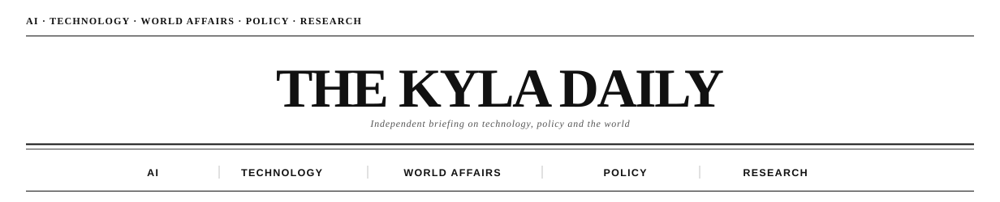
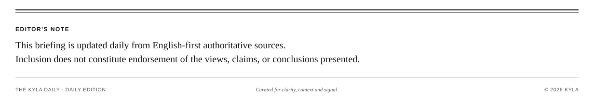

<h1 align="center">Hi 👋, I'm Kyla</h1>
<h3 align="center">Building auditable AI systems: agents, workflow verification, and product infrastructure.</h3>

AI Engineer · Cornell Tech Research Assistant · Open-source Author

  

<!-- Daily Briefing:START -->

  
   
  Vol. 066 - Tuesday, November 3, 2026
  

<table align="center" width="88%">
  <tr>
    <td width="50%"><strong>Agents get their own locked rooms</strong>  Amjad Masad argues that workplace agents should run in dedicated, organization-controlled environments with access limited to each task. As agents gain operational reach, isolation and least privilege are becoming product requirements rather than infrastructure details.  Source: <a href="https://x.com/amasad/status/2117499074496872882">Amjad Masad</a></td>
    <td width="50%"><strong>A useful sandbox carries a working identity</strong>  Guillermo Rauch says stateless execution misses what makes agents productive: persistent identity, skills, repositories and memory. The emerging infrastructure contest is therefore not just about startup speed, but about preserving a secure workspace across long-running jobs.  Source: <a href="https://x.com/rauchg/status/2117338179535810957">Guillermo Rauch</a></td>
  </tr>
  <tr>
    <td width="50%"><strong>Legal AI learns behind closed doors</strong>  Legora's agents route subtasks across models while working with confidential legal data that product teams often cannot inspect directly. Better citation reliability and domain-specific workflows show why specialized agents compete on orchestration, trust and evaluation, not only model intelligence.  Source: <a href="https://www.youtube.com/@LatentSpacePod">Latent Space</a></td>
    <td width="50%"><strong>Greenland opens the door to more U.S. bases</strong>  Greenlandic lawmakers approved a security pact with Denmark and the United States that expands the American military presence while preserving Danish control and future independence options. The deal eases months of sovereignty tension by converting pressure into a negotiated Arctic framework.  Source: <a href="https://apnews.com/article/33824857ac4312c5ebd53821187ecc13">AP News</a></td>
  </tr>
  <tr>
    <td colspan="2"><strong>Old tuna buoys become ocean sentinels</strong>  Researchers repurposed retired fishing buoys into satellite-linked acoustic observatories across reefs and seamounts in the western Indian Ocean. The pilot captured high-frequency biomass patterns in remote waters, offering a lower-cost path to marine monitoring while stressing the need for longer deployments and biological calibration.  Source: <a href="https://www.nature.com/articles/s41598-026-72665-x">Scientific Reports</a></td>
  </tr>
</table>

  

<!-- Daily Briefing:END -->

<h3 align="left">Connect with me</h3>

  

<h3 align="left">Languages and Tools</h3>

  

<h3 align="left">GitHub Stats</h3>

  
  

