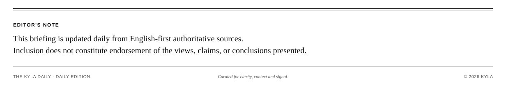

<h1 align="center">Hi 👋, I'm Kyla</h1>
<h3 align="center">Building auditable AI systems: agents, workflow verification, and product infrastructure.</h3>

AI Engineer · Cornell Tech Research Assistant · Open-source Author

  

<!-- Daily Briefing:START -->

  
   
  Vol. 089 - Thursday, November 26, 2026
  

<table align="center" width="88%">
  <tr>
    <td width="50%"><strong>OpenAI pilots private inference</strong>  OpenAI says it is testing Private Inference with a small group of customers. It also says its Private Safety Processing option can run automated safety reviews without giving OpenAI personnel access to the underlying content when used with zero data retention.  Source: <a href="https://x.com/sama/status/2125638790593274259">Sam Altman</a></td>
    <td width="50%"><strong>Gemini adds 66 regional voice options</strong>  Google’s Josh Woodward says Gemini has added 66 voice options featuring local accents. The rollout highlights how spoken assistants can adapt to regional speech within and across languages.  Source: <a href="https://x.com/joshwoodward/status/2125641468421546107">Josh Woodward</a></td>
  </tr>
  <tr>
    <td width="50%"><strong>A billing correction changes GPT-6.2 usage limits</strong>  OpenAI’s Thibault Sottiaux says a launch error discounted Astra and Sol usage for most users. After the fix, he says users will reach their plan limits 40% faster on Astra and 25% faster on Sol compared with the previous week.  Source: <a href="https://x.com/thsottiaux/status/2125784147889393806">Thibault Sottiaux</a></td>
    <td width="50%"><strong>Trading partners push back on proposed US tariffs</strong>  China, Japan and other US trading partners challenged Washington’s proposed tariff increases and disputed its claims of excess manufacturing capacity. The European Union also rejected that premise after facing a potential 15% tariff rate.  Source: <a href="https://apnews.com/article/b94a693004ad8f9b5e78f7aafb196a71">Associated Press</a></td>
  </tr>
  <tr>
    <td colspan="2"><strong>Observed warming sharpens Arctic snow forecasts</strong>  Researchers used historical warming to narrow the spread of Northern Hemisphere snow-cover projections. Under the study’s high-emissions scenario, the resulting models point to snow-free Arctic summers by the 2040s.  Source: <a href="https://www.nature.com/articles/s41467-026-79797-8_reference.pdf">Nature Communications</a></td>
  </tr>
</table>

  

<!-- Daily Briefing:END -->

<h3 align="left">Connect with me</h3>

  

<h3 align="left">Languages and Tools</h3>

  

<h3 align="left">GitHub Stats</h3>

  
  

