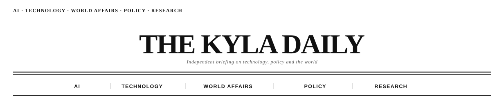
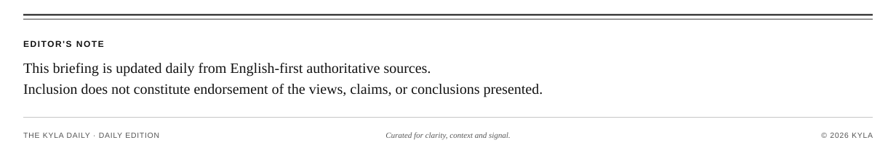

<h1 align="center">Hi 👋, I'm Kyla</h1>
<h3 align="center">Building auditable AI systems: agents, workflow verification, and product infrastructure.</h3>

AI Engineer · Cornell Tech Research Assistant · Open-source Author

  

<!-- Daily Briefing:START -->

  
   
  Vol. 049 - Saturday, October 17, 2026
  

<table align="center" width="88%">
  <tr>
    <td width="50%"><strong>Code review becomes an always-on teammate</strong>  Anthropic's Boris Cherny says Claude Code Review now runs across all of his pull requests and catches bugs before they land. The workflow points to a quieter form of agent adoption: not replacing the engineer, but placing persistent scrutiny inside the delivery pipeline so speed and quality can rise together.  Source: <a href="https://x.com/bcherny/status/2111158313463525518">Boris Cherny</a></td>
    <td width="50%"><strong>Enterprise AI moves into the customer's cloud</strong>  Replit says it can deploy its platform inside a customer's own cloud so data stays within the organization's environment. The offer targets governments, finance and healthcare, where AI adoption depends as much on control, residency and auditability as it does on model capability.  Source: <a href="https://x.com/amasad/status/2111267314012496121">Amjad Masad</a></td>
  </tr>
  <tr>
    <td width="50%"><strong>Cyber defenders get a narrowing head start</strong>  OpenAI president Greg Brockman argues that frontier models currently give defenders an advantage before comparable offensive capability diffuses widely. He says organizations should use this window to find and repair old vulnerabilities, treating AI security spending as a structural requirement rather than an add-on to software budgets.  Source: <a href="https://www.youtube.com/@NoPriorsPodcast">No Priors</a></td>
    <td width="50%"><strong>The IMF calls for barriers around the AI race</strong>  At the IMF-World Bank meetings, Kristalina Georgieva urged guardrails that preserve AI's economic promise without allowing failures to harm workers and societies. The warning places governance alongside debt, jobs and growth as a core macroeconomic question rather than a specialist technology debate.  Source: <a href="https://apnews.com/article/faba248f0609534a0d8284dec1b46a81">Associated Press</a></td>
  </tr>
  <tr>
    <td colspan="2"><strong>A mitochondrial atlas widens biology's family tree</strong>  Scientists have catalogued mitochondrial proteins across five single-celled parasites and one plant, moving beyond the human-and-yeast bias of earlier maps. Shared parasite proteins absent from humans could expose drug targets, while the comparisons revive questions about when and how mitochondria evolved.  Source: <a href="https://www.nature.com/articles/d41586-026-03195-9">Nature</a></td>
  </tr>
</table>

  

<!-- Daily Briefing:END -->

<h3 align="left">Connect with me</h3>

  

<h3 align="left">Languages and Tools</h3>

  

<h3 align="left">GitHub Stats</h3>

  
  

