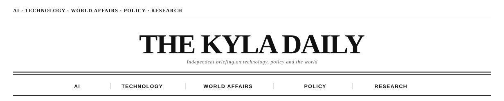

<h1 align="center">Hi 👋, I'm Kyla</h1>
<h3 align="center">Building auditable AI systems: agents, workflow verification, and product infrastructure.</h3>

AI Engineer · Cornell Tech Research Assistant · Open-source Author

  

<!-- Daily Briefing:START -->

  
   
  Vol. 088 - Wednesday, November 25, 2026
  

<table align="center" width="88%">
  <tr>
    <td width="50%"><strong>Claude Code gains instructions bundled with MCP servers</strong>  Anthropic’s Boris Cherny says MCP servers can now ship with skills that explain how Claude Code should use them. Tool providers can package usage guidance alongside the integration, giving users less setup to do themselves.  Source: <a href="https://x.com/bcherny/status/2125292098165612585">Boris Cherny</a></td>
    <td width="50%"><strong>ChatGPT Business gets a year-end fast-mode offer</strong>  OpenAI’s Thibault Sottiaux announced a banked reset for ChatGPT Business teams and said fast mode would be available at no extra charge through December 31. The announcement gives teams a defined window to try the faster setting.  Source: <a href="https://x.com/thsottiaux/status/2125299248782778588">Thibault Sottiaux</a></td>
  </tr>
  <tr>
    <td width="50%"><strong>Vercel’s coding agent aims beyond the terminal</strong>  Vercel CEO Guillermo Rauch says its command-line tool is a thin wrapper around libfx. The project aims to make the same coding-agent core embeddable in browsers, servers, desktop apps and mobile products.  Source: <a href="https://x.com/rauchg/status/2125320020666565096">Guillermo Rauch</a></td>
    <td width="50%"><strong>Chip controls put Nvidia’s China strategy under scrutiny</strong>  On Unsupervised Learning, ChinaTalk’s Jordan Schneider discusses the tension between Nvidia’s effort to diversify beyond its largest cloud customers and US restrictions on advanced chip sales to China. The interview examines how access to AI computing power shapes both company strategy and US–China relations.  Source: <a href="https://www.youtube.com/watch?v=gkd5eOQGASU">Unsupervised Learning</a></td>
  </tr>
  <tr>
    <td colspan="2"><strong>A sudden lake drain can slow Greenland ice for years</strong>  Decades of observations from a glacier in southwest Greenland show that major lake drainages can briefly speed up ice flow before slowing it for years. Researchers attribute the slowdown to a drainage channel that lowers water pressure beneath the ice and increases friction against the bed.  Source: <a href="https://www.nature.com/articles/s41467-026-79659-3_reference.pdf">Nature Communications</a></td>
  </tr>
</table>

  

<!-- Daily Briefing:END -->

<h3 align="left">Connect with me</h3>

  

<h3 align="left">Languages and Tools</h3>

  

<h3 align="left">GitHub Stats</h3>

  
  

